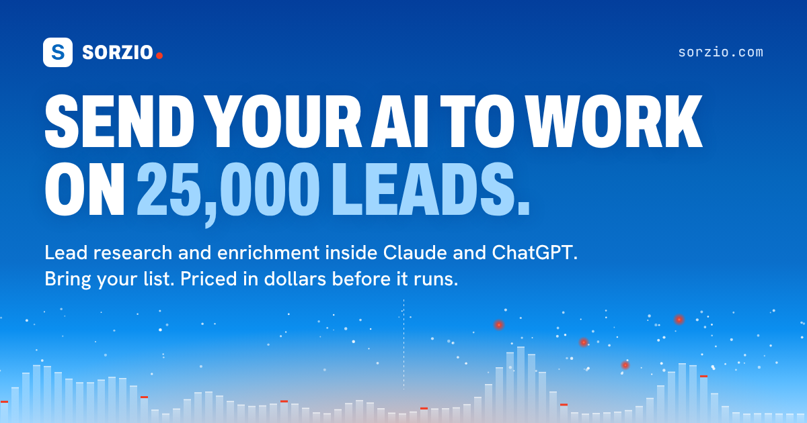
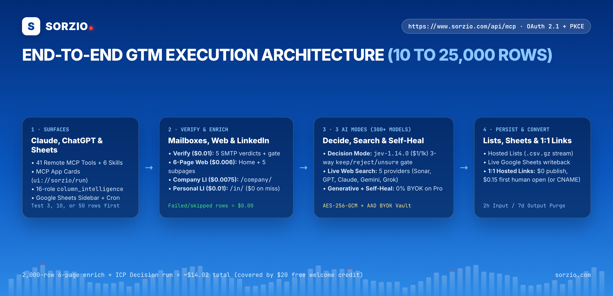
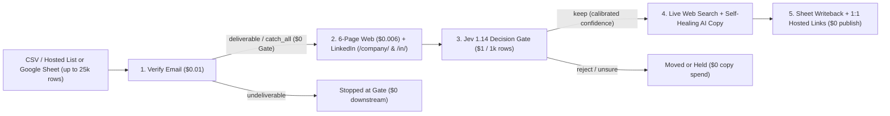

<div align="center">
  <a href="https://www.sorzio.com">
    
  </a>

  <br />

  <h1>Sorzio MCP Server &amp; Claude Plugin</h1>
  <p><strong>Bulk B2B Enrichment, Mailbox Verification, Calibrated ICP Scoring &amp; Outbound Execution for AI Agents and Google Sheets</strong></p>

  <p>
    <a href="https://www.sorzio.com/api/mcp"></a>
    <a href="https://www.sorzio.com/mcp"></a>
    <a href="#complete-mcp-tool-reference"></a>
    <a href="#3-distinct-ai-modes-300-models"></a>
    <a href="./LICENSE"></a>
  </p>

  <p>
    <a href="https://www.sorzio.com"><strong>Website</strong></a> ·
    <a href="https://www.sorzio.com/mcp"><strong>MCP Hub</strong></a> ·
    <a href="https://www.sorzio.com/claude"><strong>Claude Guide</strong></a> ·
    <a href="https://workspace.google.com/marketplace/app/replylabs_ai_verify_scrape_for_sheets/860378915175"><strong>Google Sheets Add-On</strong></a> ·
    <a href="https://www.sorzio.com/tools/cold-email-cost-calculator"><strong>Cost Calculator</strong></a> ·
    <a href="https://www.sorzio.com/llms-full.txt"><strong>llms-full.txt</strong></a>
  </p>
</div>

---

## Why Sorzio Exists

Chat windows excel at reasoning over **3 to 10 sample leads**, tightening ICP criteria, and refining outbound copy. They break down when you drop **500, 2,000, or 25,000 leads** into context: tokens blow up, live mailbox SMTP checks are impossible, LinkedIn and JavaScript websites block plain fetches, and results vanish when the chat ends.

**Sorzio (`https://www.sorzio.com/api/mcp`) is the server-side GTM execution engine behind your AI agent and Google Sheets:**

1. **You bring the GTM expertise:** your ICP qualifiers, disqualifiers, and outbound angle.
2. **Claude or ChatGPT brings the interactive judgment:** inspects headers via 16-role `column_intelligence`, compiles calibrated rubrics or prompts, and tests them on **3, 10, or 50 rows** first.
3. **Sorzio executes at scale (up to 25,000 rows/run):** verifies mailboxes, crawls up to 6 pages per company domain plus LinkedIn `/company/` and `/in/` profiles, scores ICP fit at `$1.00 / 1,000` rows, writes self-healing copy, publishes `1:1` prospect microsites, and streams results into Hosted Lists (`.csv.gz`) or live **Google Sheets** while billing **only succeeded rows**.

<p align="center">
  
</p>



---

## Quick Setup (Remote Streamable HTTP MCP)

Sorzio runs as a zero-install **Streamable HTTP MCP server** at `https://www.sorzio.com/api/mcp` secured by **OAuth 2.1 + PKCE (`S256`)** with lazy sign-in (read-only discovery and cost estimation work immediately; workspace sign-in opens only when needed).

### 1. Claude.ai, Claude Desktop &amp; Claude Mobile (iOS / Android)
Open **Settings -> Connectors -> Add custom connector**:
- **Name:** `Sorzio`
- **Remote MCP server URL:** `https://www.sorzio.com/api/mcp`

### 2. Claude Code (CLI &amp; Plugin)
```bash
# Connect the remote MCP server directly:
claude mcp add --transport http sorzio https://www.sorzio.com/api/mcp
```

### 3. ChatGPT (Connectors / Developer Mode)
Open **Settings -> Connectors -> Create** and enter `https://www.sorzio.com/api/mcp` with OAuth 2.1 automatic discovery enabled.

### 4. Cursor / Windsurf / VS Code (`.mcp.json`)
```json
{
  "mcpServers": {
    "sorzio": {
      "type": "http",
      "url": "https://www.sorzio.com/api/mcp"
    }
  }
}
```

### 5. Google Sheets Native Add-On
Install **Sorzio: AI, Email Verifier &amp; Scraper for Sheets** from the [Google Workspace Marketplace](https://workspace.google.com/marketplace/app/replylabs_ai_verify_scrape_for_sheets/860378915175). Any sheet opened with the add-on is automatically accessible from Claude and ChatGPT via `list_sheets`, `read_sheet`, `run_flow`, and `create_schedule`.

---

## The 5 Capability Pillars

### 1. Mailbox Email Verification (`$0.01 / email` = `$10 / 1,000`)
- Writes one of 5 exact mailbox verdicts per row: `deliverable`, `undeliverable`, `catch_all`, `risky`, or `unknown`.
- Pairs with the **$0 Email Verdict Checkpoint** inside Flows to strip `undeliverable` and `risky` rows before you spend a cent on LinkedIn or AI steps.

### 2. Multi-Page Website &amp; LinkedIn Enrichment (`#not_found = $0`)
| Enrichment Engine | Rate (Succeeded Row) | What It Extracts |
| :--- | :--- | :--- |
| **Default Website (`subpages` bundle)** | **`$0.006 / URL`** (`$6.00 / 1k`) | Crawls **Home + up to 3 high-signal subpages** (`/about`, `/products`, `/case-studies`, `/pricing`, `/careers`, up to 6 pages total) at **`$0` extra** with automatic server-side fallback rescue at the same `$0.006` rate. |
| **Jina Reader** | **`$0.005 / URL`** (`$5.00 / 1k`) | Fast clean Markdown extraction for static company pages. |
| **Firecrawl JS** | **`$0.0075 / URL`** (`$7.50 / 1k`) | Headless JavaScript rendering for single-page apps and dynamic sites. |
| **Company LinkedIn (`/company/`)** | **`$0.0075 / row`** (`$7.50 / 1k`) | Structured company overview, industry, headcount range, specialties, headquarters, and follower data (`replylabs-linkedin`). |
| **Personal LinkedIn (`/in/`)** | **`$0.01 / row`** (`$10.00 / 1k`) | Full name, headline, current role, company, location, career history, education, and skills (`linkedin-person`). Unresolved `#not_found` profiles charge **`$0.00`**. |

### 3. 3 Distinct AI Modes (300+ Models Across 16+ Providers)
- **Mode A: Calibrated Decision Mode (`typesafe-ai/jev-1.14.0`, `$1.00 / 1,000` rows):** Non-generative calibrated probability model (`$0.0010/row` base + `1.25x` input tokens = `~$1.01 / 1k`). Compiles plain-English ICP criteria via `compile_decision_profile` into versioned `DecisionSpec` rubrics answering **1 to 12 `choice`, `boolean`, or `score` subquestions** in a single pass.
- **Mode B: 5-Provider Live Web Search:** Grounded real-time web research per row via `perplexity/sonar` (`~$8.78 / 1k` all-in) or native `web_search: true` on **OpenAI**, **Anthropic Claude**, **Google Gemini**, and **xAI Grok** for funding announcements, leadership hires, tech-stack signals, and press triggers.
- **Mode C: Generative AI + Jev Self-Healing Copy (`verifyOutput: true`):** 300+ models across OpenAI, Anthropic, Google, Mistral, DeepSeek, xAI, and Qwen (`1.65x` tokens + `$0.0035/row` on platform keys, or **`0%` markup + `$0` base fee** with your own AI API keys on **Pro `$39/mo`**). Enabling `verifyOutput: true` audits every row (`is_grounded` + `follows_instructions`) and runs 1 automatic self-healing revision when a draft hallucinates or drifts.

### 4. Multi-Step DAG Flows, 5 Checkpoints, 16-Role `column_intelligence` &amp; Schedules
- **16-Role `column_intelligence`:** `read_sheet` and `get_rows` automatically classify columns (`email`, `website_url`, `company_linkedin_url`, `person_linkedin_url`, `job_title`, `company_name`, `person_name`, `location`, etc.) and return `recommended_bindings`.
- **5 Checkpoint Types:** (1) *Did the step work?* (`$0`), (2) *Email verdict* (`$0`), (3) *Column value* (`$0`), (4) *Ask the AI*, and (5) *Decision Gate* (`gateType: "decision"`, 3-way `keep` / `reject` / `unsure` routing with `avoided_spend_estimate_cents` reporting).
- **Safe Test Loop + Interactive MCP App Cards:** Test any Flow on **3, 10, or 50 rows** first (test runs execute every step and mark verdicts without deleting, moving, or hiding rows). In Claude, `ui://sorzio/run` and `ui://sorzio/home` render live interactive Run/Test cards.
- **Recurring Watermark Schedules (Pro &amp; Scale):** `create_schedule` runs saved Flows daily, weekly, or monthly on Google Sheets, processing only newly appended rows below the high-water mark.

### 5. `1:1` Personalized Prospect Hosted Links (`$0.00` to Publish)
- Publish up to **25,000 personalized outbound microsites** across 4 executive archetypes (*Market &amp; Buying-Signal Map*, *1-Page Outbound &amp; Funnel Teardown*, *Competitor Wedge &amp; Gap Matrix*, *Pipeline &amp; Signal ROI Blueprint*) with `obsidian` or `editorial` themes and zero-link Step 1 cold-email permission hooks.
- **$0.00 to publish** 2,000 or 100,000 pages; **$0.15 once** on the first verified human open (`$0.00` for bots, email security scanners, workspace previews, and repeat opens), or **$99/mo Hosted Links Add-On** for unlimited opens (`$0/open`) + **1 Custom CNAME domain** (`brief.yourdomain.com`).

---

## Complete MCP Tool Reference

### Onboarding, Workspace, Models &amp; Cost Estimation (6 Tools)
| Tool | Cost | Purpose |
| :--- | :--- | :--- |
| `get_started` | Free | Workspace balance, plan, starter Flows, and `where_to_begin` tool-routing guide. |
| `open_dashboard` | Free | Interactive `ui://sorzio/home` card with balance, top-up link, saved Flows, and recent runs. |
| `get_account` | Free | Workspace name, live balance, auto-recharge settings, and active BYOK providers. |
| `list_models` | Free | 300+ models across 16+ providers with price per 1k rows, `supports_web_search`, and reasoning flags. |
| `estimate_cost` | Free | Exact pre-flight dollar estimate for any AI, Verify, Enrich, or multi-step Flow run. |
| `get_history` | Free | Recent batch runs across MCP and the Google Sheets add-on with row counts and charges. |

### Hosted Lists &amp; Google Sheets with 16-Role `column_intelligence` (9 Tools)
| Tool | Cost | Purpose |
| :--- | :--- | :--- |
| `list_lists` / `create_list` / `add_rows` | Free | Create inline lists (up to 5,000 rows) or signed CSV upload URLs (up to 25,000 rows). |
| `get_rows` | Free | Page up to 200 rows with automatic 16-role `column_intelligence` and `recommended_bindings`. |
| `export_list` | Free | Interactive searchable web table (`page_url`) + streaming `.csv.gz` download. |
| `delete_list` / `purge_lists` | Free | Immediate deletion of one Hosted List or bulk purge of idle/temporary lists and archives. |
| `list_sheets` / `read_sheet` | Free | List connected Google Sheets and read headers + sample rows with `column_intelligence`. |

### Prompt Library, Batch Execution &amp; Run Data (13 Tools)
| Tool | Cost | Purpose |
| :--- | :--- | :--- |
| `list_prompts` / `get_prompt` / `save_prompt` / `delete_prompt` | Free | Manage shared workspace prompts and Google Sheets add-on Library prompts. |
| `preview_prompt` | Real cost | Test a prompt synchronously on 1 to 3 real rows and inspect outputs + exact cost. |
| `run_ai` / `run_verify` / `run_scrape` | Usage | Launch background AI, mailbox verification, or 6-page web / LinkedIn enrichment batches. |
| `get_run` / `cancel_run` / `retry_failed` | Free / Usage | Long-poll up to 50s (`quality` summary + 3 samples), cancel + refund hold, or retry failed rows. |
| `get_run_rows` / `export_run` | Free | Inspect or export processed `batch_job_rows` directly as RFC 4180 CSV or JSON. |

### Multi-Step DAG Flows, Watermark Schedules, Decision Mode &amp; Hosted Links (19 Tools)
| Tool | Cost | Purpose |
| :--- | :--- | :--- |
| `list_flows` / `get_flow` / `save_flow` / `delete_flow` | Free | Author, version, inspect (`last_test`), duplicate, or archive v2 multi-step DAG Flows. |
| `run_flow` / `get_flow_run` / `cancel_flow_run` | Usage / Free | Test on 3, 10, or 50 rows (marks verdicts safely) or run across all 25,000 rows with live cards. |
| `list_schedules` / `create_schedule` / `delete_schedule` | Free (runs billed) | Schedule daily, weekly, or monthly watermark Flow crons on connected Google Sheets. |
| `compile_decision_profile` / `save_decision_profile` / `list_decision_profiles` / `get_decision_profile` | Free | Compile plain-English ICP criteria into weighted `DecisionSpec` rubrics and starter templates. |
| `preview_decision` / `run_decide` | Free / `$1/1k` | Calibrate `typesafe-ai/jev-1.14.0` scores on 1, 3, or 5 sample rows (free), then batch-evaluate. |
| `list_page_templates` / `publish_list_pages` / `get_page_analytics` | `$0` publish | Publish `1:1` prospect microsites (`$0.15` first human open) and read human vs bot dwell analytics. |

### 6 Bundled Agent Skills (`skills/`)
- `sorzio-quickstart`: End-to-end intake, pre-flight estimate, 3-row test, execution, and export loop.
- `sorzio-flow-builder`: Author v2 Flows, run safe 3/10/50-row tests, inspect `row_results`, and execute full runs.
- `sorzio-lead-research`: Multi-page website + LinkedIn enrichment Flow writing firmographics and buyer hooks.
- `sorzio-icp-qualification`: Calibrated `GO` / `AMBER` / `NO GO` ICP qualification Flow with reason columns and gates.
- `sorzio-email-verification`: 5-verdict mailbox verification workflow that routes undeliverable rows out cleanly.
- `sorzio-check-results`: Zero-bloat run review via `quality.verdict_line` and 3 samples without context overflow.

---

## Pricing, Plans &amp; Worked TCO Math

### Worked Example: 2,000 B2B Companies Enriched &amp; ICP-Scored (`$14.02` Total)
- **Step 1: 6-Page Website Enrichment (`$0.006 / URL`):** `2,000 x $0.006` = **`$12.00`** (`Home` + up to 3 subpages at `$0` extra)
- **Step 2: Jev 1.14 Calibrated Decision Gate (`~$1.01 / 1,000`):** `2,000 x ~$0.00101` = **`~$2.02`**
- **Total Run Cost:** **`~$14.02`** (100% covered inside your **$20 free welcome credit**; failed or skipped rows charge **$0.00**)
- **Full 4-Step Waterfall Row** (*Verify `$0.01` + 6-Page Web `$0.006` + Decide `~$0.001` or GPT-4o mini `~$0.0039`*): **`$0.0170 to $0.0199 / row`**.

### v4 Workspace Plans ([sorzio.com/#pricing](https://www.sorzio.com/#pricing))
| Plan | Monthly Fee | Seats &amp; Batch Cap | BYOK Markup | Hosted Lists &amp; Schedules |
| :--- | :--- | :--- | :--- | :--- |
| **Free** | **`$0 / mo`** | 1 seat · **5,000 rows/run** | Platform wallet (up to **$20 free credit**: `$5` instant + `$15` with Auto-Reload or `$20+` top-up) | All MCP tools, Flows &amp; Hosted Links · 2h / 7d run lists |
| **Pro** | **`$39 / mo` flat** | 1 seat · **10,000 rows/run** | **`0%` Sorzio markup + `$0` base fee on your own AI API keys** | **Scheduled Watermark Flows** (daily/weekly/monthly) · 7-day Lists |
| **Scale** | **`$99 / mo` flat** | **3 seats** (`+$19/mo` extra) · **25,000 rows/run** | **Full-stack BYOK** across AI + verification + enrichment | **Forever Hosted Lists** (cold-archive backed) + Schedules |
| **Hosted Links Add-On** | **`$99 / mo`** (any plan) | Unlimited human opens (`$0.00/open`) | Stackable on Free, Pro, or Scale | **1 Custom CNAME domain** (`+$15/mo` per extra CNAME) |

> **Prepaid Wallet &amp; Whale Bonus:** Pay-as-you-go wallet with optional Auto-Recharge (triggers `<$5`, reloads `$20` to `$10,000`) and **`+10%` bonus credit** on single reloads of `$1,000+`.

---

## Security, BYOK Encryption &amp; Data Retention

- **Context-Bound Key Vault:** Customer BYOK API keys are encrypted at rest with **AES-256-GCM + AAD** bound to your organization ID and provider, decrypted strictly inside isolated worker memory at execution time, and blocked from MCP agent token reads via Postgres RLS (`deny_agent_tokens`).
- **Short-Lived PII Hygiene:** Raw batch row inputs purge automatically after **2 hours**; row outputs purge after **7 days** (Hosted Lists on Free/Pro delete 7 days after their last run; Forever Lists on Scale persist in encrypted storage until deleted via `delete_list` or `purge_lists`).
- **Pre-Flight Spend Guardrails:** Every run over `$5`, or any run that would overwrite filled cells, pauses with `needs_confirmation` until you explicitly approve.

## What data is sent to Sorzio

When Claude uses a Sorzio tool, it sends Sorzio the rows and column names you ask it to work on (for example names, company websites, and email addresses), the prompts and settings for each run, and the ids of the lists, runs, and Flows it reads. To do the work, Sorzio passes row values to the AI, verification, and scraping providers listed at https://www.sorzio.com/subprocessors. Run outputs are kept for 7 days after a run ends, and lists Claude creates are deleted 7 days after their last run. The privacy policy is at https://www.sorzio.com/privacy.

Paid tools spend from your Sorzio workspace balance. Estimates are free, and a run over $5, or one that would overwrite filled cells, asks for your approval first.

## About Sorzio

**Sorzio** (formerly ReplyLabs) is built and operated by **Empra Consultancy LTD** (`hello@sorzio.com`, https://www.sorzio.com). Sorzio is an independent software company and is **not affiliated with Reply.io (Reply, Inc.)**.

## License

Released under the MIT License. See [`LICENSE`](./LICENSE).
